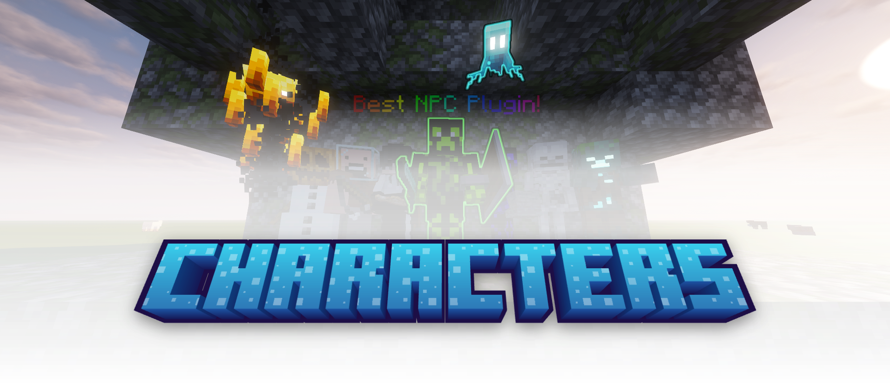

  <a href="https://thenextlvl.net/discord"></img></a>
  <a href="https://modrinth.com/project/oeBa7ep1"></img></a>
  <a href="https://github.com/TheNextLvl-net/characters"></img></a>

## The Ultimate NPC Plugin for Paper & Folia

Characters is a powerful yet easy-to-use NPC plugin for Minecraft servers,
offering full in-game customization and seamless API integration.
Whether you're creating quest NPCs, interactive traders, or custom role-play characters,
This plugin makes it simple!

## Features

- **Fully Customizable In-Game** – No configuration required, edit NPCs directly in-game  
- **Advanced Click Actions** – Define custom interactions for your NPCs  
- **Simple Yet Powerful API** – Perfect for developers to extend functionality  
- **Custom Skins** – Upload skins from **files or URLs** with ease
- **NPC Combat** – Give NPCs **weapons**, **health**, and **attack behaviors**  
- **Custom AI Goals** – Make NPCs **chase players**, **guard areas**, or **look at the nearest player**  
- **Advanced Movement** – **patrolling, following**, or **roaming behaviors**
- **Per-viewer appearance** – One character can have different appearances for each viewer
- **Per-viewer behavior** – One character can perform multiple actions at once for each viewer

[Download now](https://modrinth.com/project/oeBa7ep1)  
[Check out the Wiki](https://thenextlvl.net/docs/characters)  
[Our Maven Repository](https://repo.thenextlvl.net/#/releases/net/thenextlvl/characters)

---

